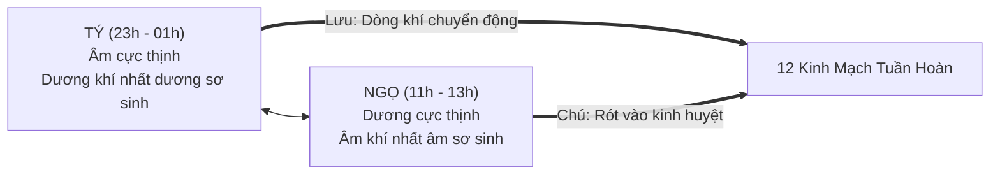
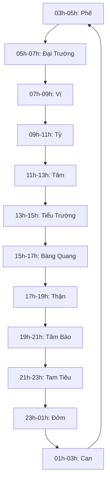

# CẨM NANG TOÀN DIỆN VỀ HỌC THUYẾT TÝ NGỌ LƯU CHÚ
## (Thời Châm Học YHCT & Nhịp Sinh Học Thời Gian Hiện Đại)

---

## MỤC LỤC
1. [Khái Niệm Cốt Lõi & Ngữ Nghĩa Triết Học](#1-khái-niệm-cốt-lõi--ngữ-nghĩa-triết-học)
2. [Cơ Chế Khoa Học & Y Lý Vận Hành](#2-cơ-chế-khoa-học--y-lý-vận-hành)
   - 2.1. Y lý Y học Cổ truyền (Khí huyết tuần hoàn khép kín)
   - 2.2. Y học Hiện đại (Sinh học thời gian - Chronobiology & Nhịp Circadian)
3. [Đồng Hồ 12 Canh Giờ Tý Ngọ Lưu Chú](#3-đồng-hồ-12-canh-giờ-tý-ngọ-lưu-chú)
4. [Phương Pháp Khai Huyệt Theo Giờ Trong Lâm Sàng](#4-phương-pháp-khai-huyệt-theo-giờ-trong-lâm-sàng)
   - 4.1. Nạp Tử Pháp (Chọn huyệt theo giờ vượng của kinh mạch)
   - 4.2. Nguyên lý Mẹ Bổ - Con Tả kết hợp Ngũ Du Huyệt
   - 4.3. Nạp Giáp Pháp (Phối hợp Thiên Can và Ngũ Du Huyệt)
   - 4.4. Linh Quy Bát Pháp & Phi Đằng Bát Pháp (Khai mở Kỳ Kinh Bát Mạch)
   - 4.5. Hiệu chỉnh Giờ Mặt Trời Thực (Chân Thái Dương Thời)
5. [Ca Lâm Sàng Thực Tiễn Điển Hình](#5-ca-lâm-sàng-thực-tiễn-điển-hình)
6. [Ứng Dụng Trong Dưỡng Sinh & Thời Dược Học](#6-ứng-dụng-trong-dưỡng-sinh--thời-dược-học)
7. [Tích Hợp Tự Động Trong Hệ Thống AcuAtlas 3D Pro](#7-tích-hợp-tự-động-trong-hệ-thống-acuatlas-3d-pro)

---

## 1. Khái Niệm Cốt Lõi & Ngữ Nghĩa Triết Học

**Tý Ngọ Lưu Chú (子午流注 - Zǐ Wǔ Liú Zhù)** là đỉnh cao của học thuyết **Thời Châm Học** trong nền Y học phương Đông, phản ánh quy luật *"Thiên nhân tương ứng"* (Con người hòa quyện cùng chu kỳ vũ trụ).

* **Tý (子):** Điểm khởi đầu của trục Tý - Ngọ (nửa đêm, 23h - 01h). Lúc này Âm khí đạt đỉnh điểm và bắt đầu thoái trào; **Dương khí bắt đầu nảy sinh** (*Nhất dương sơ sinh*).
* **Ngọ (午):** Điểm đối đỉnh (giữa trưa, 11h - 13h). Lúc này Dương khí đạt cực thịnh và bắt đầu thoái lui; **Âm khí bắt đầu tích tụ** (*Nhất âm sơ sinh*).
* **Lưu (流):** Khí huyết lưu thông tuần hoàn, liên tục chảy trong hệ thống kinh mạch như dòng sông không ngừng nghỉ.
* **Chú (注):** Dồn tụ, đổ đầy, rót tinh hoa khí huyết vào từng tạng phủ và kinh huyệt tương ứng theo từng thời khắc.

---

## 2. Cơ Chế Khoa Học & Y Lý Vận Hành

### 2.1. Y lý Y học Cổ truyền

Khí huyết của cơ thể không phân bố đồng đều tại mọi thời điểm, mà vận hành theo một trật tự thời gian khắt khe. Trong mỗi ngày đêm (24 giờ), cơ thể chia làm **12 canh giờ** (mỗi canh tương ứng 2 giờ đồng hồ). 

Tại mỗi canh giờ:
* Khí huyết dồn về **thịnh vượng nhất** tại một kinh mạch và tạng phủ đại diện.
* Tạng phủ đó hoạt động chuyển hóa, nạp năng lượng và bài độc mạnh nhất.
* Các tạng phủ còn lại duy trì ở mức cơ bản để nhường tài nguyên cho tạng phủ chủ quản canh giờ.

### 2.2. Y học Hiện đại: Nhịp Sinh Học Thời Gian (Circadian Rhythm)

Khoa học hiện đại thông qua giải Nobel Y học 2017 về **Cơ chế phân tử điều khiển nhịp sinh học** đã chứng minh tính chính xác của học thuyết Tý Ngọ Lưu Chú:
1. **Trung tâm điều hòa sinh học SCN (Suprachiasmatic Nucleus):** Nằm tại vùng dưới đồi não bộ, điều khiển nhịp tiết hormone ngày đêm.
2. **Dao động Cortisol & Huyết áp:** Tăng vọt lúc 06:00 - 08:00 sáng (trùng giờ Mão/Thìn - Đại Trường & Vị) để đánh thức cơ thể, kích hoạt nhu động ruột và đòi hỏi năng lượng bữa sáng.
3. **Chức năng Gan & Enzym khử độc (Cytochrome P450):** Tăng hoạt tính đào thải độc tố và tổng hợp glycogen vào khoảng 01:00 - 03:00 đêm (trùng giờ Sửu - Tạng Can tàng huyết và giải độc).

---

## 3. Đồng Hồ 12 Canh Giờ Tý Ngọ Lưu Chú

| Canh Giờ | Khung Giờ | Kinh Mạch Khí Huyết Vượng | Tạng Phủ Chủ Trị | Biểu Hiện Sinh Lý / Dưỡng Sinh Chuẩn |
| :---: | :---: | :--- | :--- | :--- |
| **Dần** | **03:00 – 05:00** | **Thủ Thái Âm Phế** | Phế chủ khí, triều bách mạch | Khí huyết phân bổ toàn thân. Cần ngủ sâu; tránh dậy sớm thể dục gắng sức khi trời sương lạnh. |
| **Mão** | **05:00 – 07:00** | **Thủ Dương Minh Đại Trường** | Đại trường chủ bài tiết cặn bã | Nhu động ruột mạnh nhất. Thức dậy, uống 300-500ml nước ấm, đi đại tiện thải độc. |
| **Thìn** | **07:00 – 09:00** | **Túc Dương Minh Vị** | Vị chủ thu nạp, ngấu nhừ thủy cốc | Vị toan tiết mạnh nhất. Bắt buộc phải ăn bữa sáng thịnh soạn, giàu dinh dưỡng. |
| **Tỵ** | **09:00 – 11:00** | **Túc Thái Âm Tỳ** | Tỳ chủ vận hóa, sinh huyết | Hấp thu dưỡng chất nuôi cơ nhục và não. Thời điểm não bộ tỉnh táo, học tập và làm việc hiệu quả nhất. |
| **Ngọ** | **11:00 – 13:00** | **Thủ Thiếu Âm Tâm** | Tâm chủ huyết mạch, tàng thần | Giao thời Âm - Dương. Ăn trưa nhẹ nhàng, chợp mắt ngủ trưa 15–30 phút để dưỡng tâm khí. |
| **Mùi** | **13:00 – 15:00** | **Thủ Thái Dương Tiểu Trường**| Phân tách thanh trọc | Ruột non hấp thụ tinh chất nước vào máu, đưa bã xuống đại tràng. Nên uống nước lọc. |
| **Thân** | **15:00 – 17:00** | **Túc Thái Dương Bàng Quang** | Bàng quang chủ chứa và tiết niệu | Bài tiết nước tiểu, thanh lọc cơ thể. Khả năng vận động thể lực tốt nhất trong ngày. |
| **Dậu** | **17:00 – 19:00** | **Túc Thiếu Âm Thận** | Thận tàng tinh, sinh tủy, chủ cốt | Thận lọc máu điều hòa nội môi. Ăn tối thanh đạm; thời điểm vàng uống thuốc bổ thận. |
| **Tuất** | **19:00 – 21:00** | **Thủ Quyết Âm Tâm Bào** | Tâm bào lạc bảo vệ tim, thông mạch | Máu về tim dồi dào, huyết áp hạ dần. Thư giãn, ngâm chân nước ấm, tránh xúc động mạnh. |
| **Hợi** | **21:00 – 23:00** | **Thủ Thiếu Dương Tam Tiêu** | Tam tiêu thông thủy đạo, nội tiết | Trăm mạch nghỉ ngơi, cân bằng nhiệt. Chuẩn bị giấc ngủ, tránh ăn đêm, ngưng dùng thiết bị điện tử. |
| **Tý** | **23:00 – 01:00** | **Túc Thiếu Dương Đởm** | Đởm chủ quyết đoán, tiết dịch mật | Mật tân dịch trao đổi mới. Bắt buộc phải ngủ say trước 23h để tránh sỏi mật, giảm trí nhớ. |
| **Sửu** | **01:00 – 03:00** | **Túc Quyết Âm Can** | Can tàng huyết, chủ sơ tiết | Gan lọc máu, phục hồi tế bào gan. Phải trong trạng thái ngủ say để máu dồn về dưỡng gan. |

---

## 4. Phương Pháp Khai Huyệt Theo Giờ Trong Lâm Sàng

### 4.1. Nạp Tử Pháp (Theo Giờ Vượng Của 12 Kinh Mạch)
Đây là phương pháp thông dụng và hiệu quả nhất trong thực tế điều trị:

1. **Chẩn đoán thời khắc:** Nếu bệnh nhân bộc phát triệu chứng hoặc cơn đau tăng nặng vào đúng khung giờ nào, xác định ngay kinh mạch của khung giờ đó bị bệnh.
2. **Quy tắc Tả Thực (Thực chứng):** Bệnh do tà khí tích tụ, viêm cấp, nhiệt chứng $\rightarrow$ Châm **Tả** vào chính khung giờ kinh đó vượng để xả bớt tà khí.
3. **Quy tắc Bổ Hư (Hư chứng):** Bệnh do khí huyết suy giảm, mạn tính $\rightarrow$ Châm **Bổ** đón đầu vào kinh mẹ hoặc châm bổ khi dòng khí huyết vừa bắt đầu tràn vào kinh.

### 4.2. Phối hợp Nguyên lý "Mẹ Bổ - Con Tả" với Ngũ Du Huyệt
Trong mỗi đường kinh có 5 huyệt Ngũ Du mang tính chất Ngũ Hành: **Tỉnh (Mộc/Kim), Huỳnh (Hỏa/Thủy), Du (Thổ/Mộc), Kinh (Kim/Hỏa), Hợp (Thủy/Thổ)**.

$$\text{Hư tắc bổ kỳ mẫu} \quad - \quad \text{Thực tắc tả kỳ tử}$$

* **Khi Kinh Phế Thực (Phế thuộc Kim):** Kim sinh Thủy (Thủy là con của Kim). Muốn tả Phế Thực, chọn huyệt **Hợp (Thủy)** của kinh Phế là huyệt **Xích Trạch (LU5)**.
* **Khi Kinh Can Thực (Can thuộc Mộc):** Mộc sinh Hỏa (Hỏa là con của Mộc). Muốn thanh tả Can Hỏa, chọn huyệt **Huỳnh (Hỏa)** của kinh Can là huyệt **Hành Gian (LR2)**.
* **Khi Kinh Thận Hư (Thận thuộc Thủy):** Kim sinh Thủy (Kim là mẹ của Thủy). Muốn bổ Thận Thủy, chọn huyệt **Kinh (Kim)** của kinh Thận là huyệt **Phục Lưu (KI7)**.

### 4.3. Nạp Giáp Pháp (納甲法 – Tuần Kinh Khai Huyệt Theo Thiên Can Ngày & Giờ)
Khác với **Nạp Tử Pháp** (dùng 12 Địa Chi cố định trong ngày), **Nạp Giáp Pháp** lấy **10 Thiên Can của Ngày và Giờ** phối hợp với 12 Kinh mạch và 60 Ngũ Du Huyệt theo nguyên tắc ***"Dương tiến Âm thoái, phùng Nhâm hóa Hợp"*** (Từ Phượng – *Châm Cứu Đại Toàn*):

1. **Quy nạp 10 Thiên Can vào Tạng Phủ (Thiên Can Phối Kinh):**
   - **Giáp (Dương Mộc):** Kinh Đởm (`GB`) — Khai Tỉnh Kim **Túc Khiếu Âm (`GB44`)** vào giờ Giáp Tuất.
   - **Ất (Âm Mộc):** Kinh Can (`LR`) — Khai Tỉnh Mộc **Đại Đôn (`LR1`)** vào giờ Ất Dậu.
   - **Bính (Dương Hỏa):** Kinh Tiểu Trường (`SI`) — Khai Tỉnh Kim **Thiếu Trạch (`SI1`)** vào giờ Bính Thân.
   - **Đinh (Âm Hỏa):** Kinh Tâm (`HT`) — Khai Tỉnh Mộc **Thiếu Xung (`HT9`)** vào giờ Đinh Mùi.
   - **Mậu (Dương Thổ):** Kinh Vị (`ST`) — Khai Tỉnh Kim **Lệ Đoài (`ST45`)** vào giờ Mậu Ngọ.
   - **Kỷ (Âm Thổ):** Kinh Tỳ (`SP`) — Khai Tỉnh Mộc **Ẩn Bạch (`SP1`)** vào giờ Kỷ Tỵ.
   - **Canh (Dương Kim):** Kinh Đại Trường (`LI`) — Khai Tỉnh Kim **Thương Dương (`LI1`)** vào giờ Canh Thìn.
   - **Tân (Âm Kim):** Kinh Phế (`LU`) — Khai Tỉnh Mộc **Thiếu Thương (`LU11`)** vào giờ Tân Mão.
   - **Nhâm (Dương Thủy):** Kinh Bàng Quang (`BL`) — Khai Tỉnh Kim **Chí Âm (`BL67`)** vào giờ Nhâm Dần.
   - **Quý (Âm Thủy):** Kinh Thận (`KI`) — Khai Tỉnh Mộc **Dũng Tuyền (`KI1`)** vào giờ Quý Sửu *(Tâm Bào & Tam Tiêu ký gửi vào Thận & Bàng Quang vào các giờ cuối chu kỳ)*.
2. **Quy tắc "Phản bổn hoàn nguyên" (Quá Nguyên Hồi Nguyên):**
   - Sau khi mở huyệt Tỉnh ở giờ khởi đầu, cứ cách một canh giờ đồng tính (Dương đi với Dương, Âm đi với Âm) lại tuần tự mở sang **Huỳnh $\rightarrow$ Du $\rightarrow$ Nguyên (với Kinh Dương) $\rightarrow$ Kinh $\rightarrow$ Hợp** theo chiều Ngũ hành tương sinh.

### 4.4. Linh Quy Bát Pháp (靈龜八法) & Phi Đằng Bát Pháp (飛騰八法)
**Linh Quy Bát Pháp** (còn gọi là *Kỳ Kinh Nạp Quái Pháp*) kết hợp **8 Huyệt Giao Hội Kỳ Kinh Bát Mạch** với **Cửu Cung Bát Quái (Lạc Thư)** và đại số **Can Chi Ngày – Giờ**:

$$\text{Tổng Đại Số } (S) = \text{Đại số Can Ngày} + \text{Đại số Chi Ngày} + \text{Đại số Can Giờ} + \text{Đại số Chi Giờ}$$

* **Ngày Dương (`Giáp, Bính, Mậu, Canh, Nhâm`):** Lấy $R = S \bmod 9$ (nếu chia hết thì lấy $R = 9$).
* **Ngày Âm (`Ất, Đinh, Kỷ, Tân, Quý`):** Lấy $R = S \bmod 6$ (nếu chia hết thì lấy $R = 6$).
* **Bảng Ánh Xạ Cửu Cung – Bát Quái – Bát Mạch Giao Hội:**
  - **Số 1 (Khảm Thủy):** Khai **Thân Mạch (`BL62` – Dương Kiều)**, ứng phối **Hậu Khê (`SI3` – Đốc Mạch)**.
  - **Số 2 (Khôn Thổ) & Số 8 (Cấn Thổ):** Khai **Chiếu Hải (`KI6` – Âm Kiều)**, ứng phối **Liệt Khuyết (`LU7` – Nhâm Mạch)**.
  - **Số 3 (Chấn Mộc):** Khai **Ngoại Quan (`TE5` – Dương Duy)**, ứng phối **Túc Lâm Khấp (`GB41` – Đới Mạch)**.
  - **Số 4 (Tốn Mộc):** Khai **Túc Lâm Khấp (`GB41` – Đới Mạch)**, ứng phối **Ngoại Quan (`TE5` – Dương Duy)**.
  - **Số 5 (Trung Cung):** Nam ký Khôn cung khai **Chiếu Hải (`KI6`)**, Nữ ký Cấn cung khai **Chiếu Hải (`KI6`) / Nội Quan (`PC6`)**.
  - **Số 6 (Càn Kim):** Khai **Công Tôn (`SP4` – Xung Mạch)**, ứng phối **Nội Quan (`PC6` – Âm Duy)**.
  - **Số 7 (Đoài Kim):** Khai **Hậu Khê (`SI3` – Đốc Mạch)**, ứng phối **Thân Mạch (`BL62` – Dương Kiều)**.
  - **Số 9 (Ly Hỏa):** Khai **Nội Quan (`PC6` – Âm Duy)**, ứng phối **Công Tôn (`SP4` – Xung Mạch)**.

### 4.5. Hiệu Chỉnh Giờ Mặt Trời Thực (Chân Thái Dương Thời – True Solar Time)
Múi giờ hành chính Việt Nam (`UTC+7`) được lấy chuẩn theo kinh tuyến $105^\circ\text{Đ}$. Trong Thời Châm Học chính xác (đặc biệt tại thời điểm giao canh giữa hai giờ Địa Chi), cần quy đổi sang **Giờ Mặt Trời Thực (Chân Thái Dương Thời)**:

$$\text{Giờ Mặt Trời Thực} = \text{Giờ Hành Chính} + 4\text{ phút} \times (\lambda_{\text{địa phương}} - 105^\circ) + \Delta t_{\text{EoT}}$$

*(Trong đó Hà Nội $\lambda \approx 105.85^\circ\text{Đ}$ sớm hơn $+3.4$ phút; TP.HCM $\lambda \approx 106.66^\circ\text{Đ}$ sớm hơn $+6.6$ phút; $\Delta t_{\text{EoT}}$ là phương trình thời gian theo quỹ đạo elip của Trái Đất).*

---

## 5. Ca Lâm Sàng Thực Tiễn Điển Hình

### Ca 1: Cơn Hen Phế Quản Co Thắt & Ho Rạng Sáng (Giờ Dần: 03h - 05h)
* **Bệnh cảnh:** Bệnh nhân nam 48 tuổi, tiền sử viêm phế quản mạn tính, đêm ngủ bình thường nhưng cứ đến đúng khoảng 03:30 – 04:30 sáng là lên cơn ho sặc sụa, rít khó thở, đờm vàng đặc dính, ngực tức.
* **Biện chứng:** Giờ Dần là lúc khí huyết toàn thân triều về kinh Phế. Do phế có đàm nhiệt ứ trệ, dòng chính khí dồn về gặp tà khí bế tắc gây bốc ngược lên thành ho suyễn (*Khí nghịch thượng xung*).
* **Phác đồ Tý Ngọ Lưu Chú:**
  - Châm tả **Xích Trạch (LU5)**: Hợp Thủy huyệt kinh Phế (*Thực tắc tả kỳ tử* – tháo ngòi đàm nhiệt).
  - Bấm tả **Khổng Tối (LU6)**: Khích huyệt chuyên cắt cơn suyễn cấp tính và cầm đau tức ngực.
  - Phối hợp **Trung Phủ (LU1)**: Mộ huyệt của Phế để giáng khí điều hòa.
* **Kết quả:** Sau khi bấm Khổng Tối và châm Xích Trạch trong giờ Dần, cơn ho dịu ngay sau 7 phút, đường thở thông thoáng.

---

### Ca 2: Đau Quặn Thượng Vị & Trào Ngược Dạ Dày (Giờ Thìn: 07h - 09h)
* **Bệnh cảnh:** Nữ 35 tuổi, nhân viên văn phòng, thường xuyên bỏ bữa sáng. Cứ đến khoảng 07:30 – 08:30 sáng là xuất hiện cơn đau quặn vùng thượng vị, ợ chua cay rát cổ họng, cồn cào buồn nôn.
* **Biện chứng:** Giờ Thìn khí huyết dồn vào kinh Vị, toan vị tiết ra ở mức cao nhất. Dạ dày rỗng không có thức ăn nghiền nát, axit tấn công niêm mạc dạ dày gây viêm loét xung huyết (*Vị nhiệt thịnh*).
* **Phác đồ Tý Ngọ Lưu Chú:**
  - Châm bình bổ bình tả **Túc Tam Lý (ST36)**: Hợp Thổ huyệt kinh Vị, điều hòa nhu động và ức chế tiết toan quá mức.
  - Châm tả **Nội Quan (PC6)**: Thông qua Bát mạch giao hội liên kết với mạch Âm duy, hòa vị giáng nghịch chỉ ẩu (chống nôn, hết ợ chua tức thì).
  - Châm **Trung Quản (CV12)**: Mộ huyệt của Vị để lý khí hòa trung.

---

### Ca 3: Thức Giấc Nửa Đêm & Bốc Hỏa Cáu Gắt (Giờ Sửu: 01h - 03h)
* **Bệnh cảnh:** Nam 42 tuổi, giám đốc doanh nghiệp, công việc nhiều áp lực. Đêm ngủ dễ chập chờn nhưng luôn thức giấc đúng 01:30 – 02:00 sáng, người bứt rứt, miệng đắng chát, mắt khô đỏ, trằn trọc đến sáng không ngủ lại được.
* **Biện chứng:** Giờ Sửu là giờ vượng của Tạng Can. Can tàng huyết và chủ sơ tiết tình chí. Áp lực uất kết hóa hỏa (*Can khí uất kết hóa hỏa*), đến giờ vượng can hỏa bốc lên quấy nhiễu tâm thần khiến người bệnh giật mình thức giấc.
* **Phác đồ Tý Ngọ Lưu Chú:**
  - Châm tả **Hành Gian (LR2)**: Huỳnh Hỏa huyệt của kinh Can để rút sạch nhiệt hỏa ở tạng can (*Tả hỏa bình can*).
  - Châm bình tả **Thái Xung (LR3)**: Nguyên huyệt của kinh Can để sơ can giải uất, thông đạt khí cơ.
  - Phối hợp **Thần Môn (HT7)** và **Tam Âm Giao (SP6)**: Dưỡng âm an thần, đưa khí huyết về tạng phủ.

---

## 6. Ứng Dụng Trong Dưỡng Sinh & Thời Dược Học

Học thuyết Tý Ngọ Lưu Chú không chỉ dành cho kim châm cứu mà còn chỉ dẫn **giờ uống thuốc và sinh hoạt hoàng kim**:

1. **Uống thuốc bổ tỳ vị, kiện tỳ hóa thấp:** Uống vào lúc **07:00 – 09:00 (giờ Thìn)** hoặc **09:00 – 11:00 (giờ Tỵ)** cùng bữa ăn sáng để hấp thu tối đa dược chất.
2. **Uống thuốc bổ thận, sinh tinh, tráng dương:** Uống vào lúc **17:00 – 19:00 (giờ Dậu - Thận kinh)** bằng nước ấm pha chút muối loãng (vị mặn dẫn thuốc vào Thận).
3. **Uống thuốc thanh can giáng hỏa, trị mất ngủ:** Uống vào lúc **20:00 – 21:00 (trước giờ Hợi)** để thuốc ngấm vào tuần hoàn trước khi Can - Đởm bước vào chu kỳ giải độc đêm.

---

## 7. Tích Hợp Tự Động Trong Hệ Thống AcuAtlas 3D Pro

Trong nền tảng **AcuAtlas 3D Pro**, học thuyết Tý Ngọ Lưu Chú được số hóa trực tiếp thành tính năng trực quan:

* **Đồng Hồ Tý Ngọ Thời Gian Thực:** Nằm trên thanh Header đầu trang (`22:56:24 • Giờ Hợi (21h-23h) • Tam Tiêu`).
* **Cơ chế Tự Động Highlight Kinh Lạc:** Hệ thống tự động tính toán thời gian thực của máy tính và kích hoạt đường kinh đang vượng trong canh giờ đó.
* **Liên kết Phác Đồ 3D:** Khi bác sĩ bấm nút "Xem" cạnh đồng hồ, camera 3D sẽ tự động định vị và chiếu sáng toàn bộ lộ trình dòng chảy kinh mạch của canh giờ hiện tại, hỗ trợ chọn huyệt chính xác đến từng phút.

---
*Tài liệu học thuật được biên soạn phục vụ công tác giảng dạy, nghiên cứu và thực hành lâm sàng Y học Cổ truyền trên nền tảng AcuAtlas 3D Pro.*

